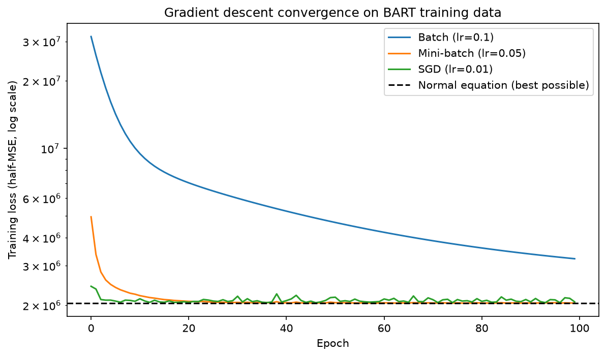
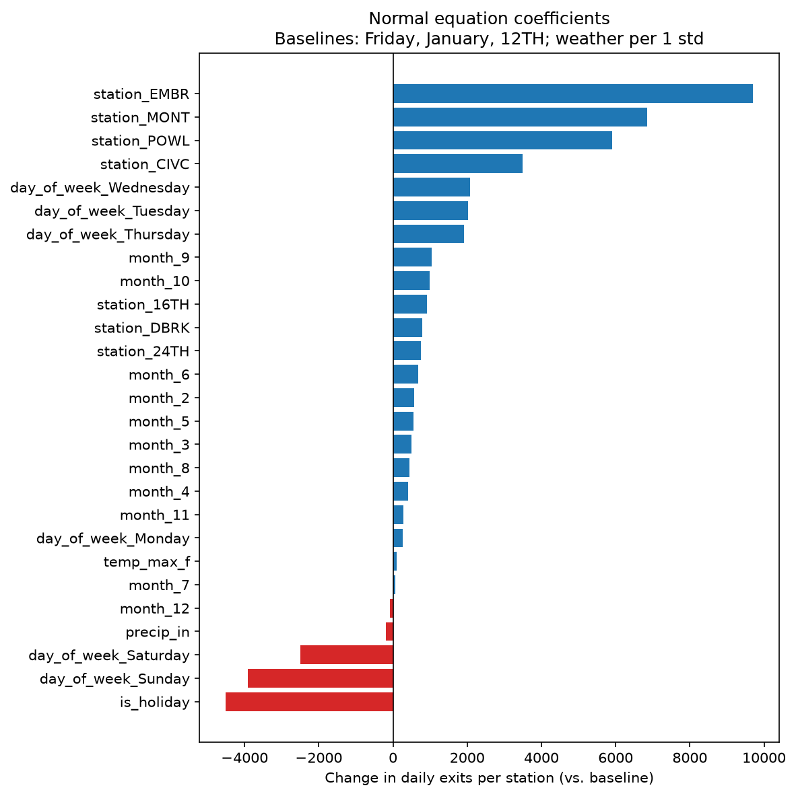
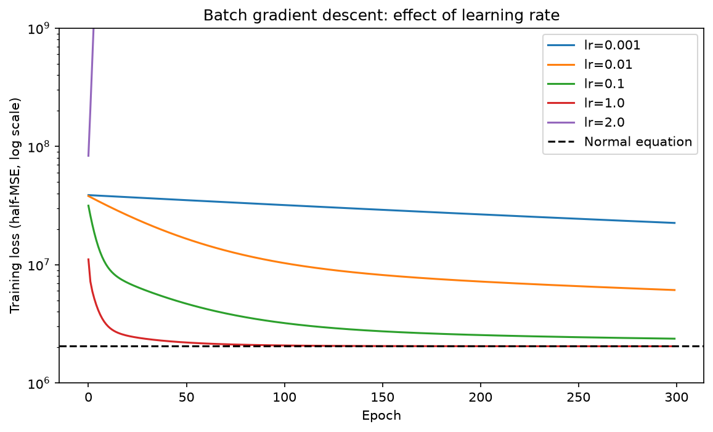

# BART Ridership Regression

I am modeling how many people exit a BART station on a given day. Ridership depends on stuff like day of the week, weather, holidays, and where the station is. For example, if it rains on a random Tuesday, how many fewer people exit at a certain station? I will do this through a multiple linear regression model.

**Result:** My from-scratch model explains about 76% of the variation in daily exits on 2025 data it never saw (test R² = 0.756, typical miss of about 1,750 riders per station-day), and it matches scikit-learn exactly.



## Data

Raw data is not committed (too large). To reproduce `data/processed/bart_daily.csv`:

1. **BART ridership:** download `date-hour-soo-dest-2024.csv.gz` and
   `date-hour-soo-dest-2025.csv.gz` (hourly origin-destination data, linked from
   [BART Ridership Reports](https://www.bart.gov/about/reports/ridership)) into `data/raw/`.
2. **Weather:** run `python scripts/download_weather.py`. This pulls daily max temperature
   and precipitation for Oakland from the [Open-Meteo Historical API](https://open-meteo.com/).
3. **Holidays:** US federal holidays from the `holidays` Python package.
4. Run `notebooks/01_eda.ipynb` top to bottom.

**Final dataset:** daily exits for the 8 busiest stations, Jan 1, 2024 to Dec 31, 2025
(5,848 rows: 8 stations × 731 days, no missing values or duplicates).

### Stations

The 8 busiest stations by total exits over 2024 to 2025:

| Code | Station |
|---|---|
| `12TH` | 12th St / Oakland City Center |
| `16TH` | 16th St Mission |
| `24TH` | 24th St Mission |
| `CIVC` | Civic Center / UN Plaza |
| `DBRK` | Downtown Berkeley |
| `EMBR` | Embarcadero |
| `MONT` | Montgomery St |
| `POWL` | Powell St |

## Variables

Each row is one station on one day (8 stations × 731 days, 2024 to 2025).

### Target
| Variable | Description |
|---|---|
| `exits` | Total trips ending at the station that day (summed from BART hourly origin-destination data) |


### Features

I implemented a total of 27 features. I did not use `date` as a feature since that was used just to split the testing and training data.

| Variable | Type | Description | Preprocessing |
|---|---|---|---|
| `temp_max_f` | Numeric | Daily max temperature (°F), Oakland | Standardized with train mean/std |
| `precip_in` | Numeric | Daily precipitation (inches), Oakland | Standardized with train mean/std |
| `is_holiday` | Binary | 1 if a US federal holiday, else 0 | None |
| `day_of_week_*` | One-hot (6 columns) | Day of week | Baseline: Friday |
| `month_*` | One-hot (11 columns) | Month (2 to 12) | Baseline: January |
| `station_*` | One-hot (7 columns) | BART station code | Baseline: `12TH` |

## Preprocessing

All preprocessing is in `src/linreg/preprocessing.py` and follows a **fit/transform** pattern: anything the pipeline learns (category lists, means, standard deviations) is learned from the training set only, then applied to both train and test.

1. **Time-based split.** I trained on 2024 and tested on 2025. I didn't split randomly, because then the model would see days right before and after each test day, which leaks future information and makes the score look better than it really is.
2. **Dummy variables.** Day of week, month, and station are turned into 0/1 columns, dropping one per category (Friday, January, 12TH). The category lists come from the training set, so train and test always end up with the same 27 columns.
3. **Scaling.** Temperature and rain are standardized with $x' = \frac{x - \mu}{\sigma}$, using the mean and standard deviation from 2024 only.

I also picked the gradient descent settings using only the training loss, and only looked at the 2025 test set once, for the final results table.

## Math

**Design matrix.** We use a matrix because there are multiple $b$ values in the linear regression (one for each feature), so instead of solving for each one separately, we solve for all of them at once to find the line of best fit. Each row of $X$ is one station-day and each column is one feature. The first column is all 1s, because that's the $a$ value (the intercept) in the linear regression. Multiplying it by 1 in every row adds it to every prediction.

$n$ is the number of equations we have, and $d$ is the number of variables. For the training data, $n = 366 \times 8 = 2928$ and $d = 27$, so with the column of 1s, $X$ is $2928 \times 28$ and $\theta$ is $28 \times 1$. The predictions are:

$$
\hat{y} = X\theta
$$

which gives one prediction per row.

**Gradient.** The loss is:

$$
J(\theta) = \frac{1}{2n}\left\| X\theta - y \right\|^2
$$

To find the gradient for one coefficient $\theta_j$, we use the chain rule, and the 2 from it cancels the $\frac{1}{2}$ in the loss. What's left is the error times the value of feature $j$, averaged over every row:

$$
\frac{\partial J}{\partial \theta_j} = \frac{1}{n}\sum_{i=1}^{n} \left(\hat{y}_i - y_i\right) x_{i,j}
$$

This gives one number per coefficient, and then $\theta_j$ is updated once. If the model is overestimating, $\theta_j$ decreases, and if it's underestimating, it increases. Doing this for every coefficient at once gives:

$$
\nabla J(\theta) = \frac{1}{n} X^\top \left(X\theta - y\right)
$$

The update is:

$$
\theta \leftarrow \theta - \alpha \nabla J(\theta)
$$

where the learning rate $\alpha$ is the step size. It stays fixed, but the steps get smaller as the errors shrink.

**Normal equation.** At the best fit, the gradient is zero, so:

$$
X^\top X \theta = X^\top y \quad \Longrightarrow \quad \theta = \left(X^\top X\right)^{-1} X^\top y
$$

This only works if $X$ has full column rank, meaning no free variables. If a column can be made from the others (multicollinearity), there are infinitely many answers and the inverse doesn't exist. That's why we dropped one dummy variable per category, since keeping all 7 weekday columns would add up to the column of 1s.

**Three types of gradient descent.** We're doing all three and comparing them with each other and with the normal equation, which gives the exact answer. The difference is how many rows are used for each update:

| Type | Rows per update | Behavior |
|---|---|---|
| Batch | All 2,928 | Smooth but slow |
| Stochastic (SGD) | 1 random row | Updates much more often, but noisy |
| Mini-batch | Small groups (e.g. 32) | In between |

They should all end up close to the normal equation's answer, so the comparison is about how fast and smoothly each one gets there.


## Coefficient interpretation

1. When looking at the biggest drop, when there is a holiday, we lose on average about 4,500 people exiting per station that day, so holidays have fewer people exiting the BART.
2. Monday and Friday have roughly the same amount of exits, as we saw in the average daily BART exits by day of week plot. Tuesday through Thursday have about 2,000 more people exiting each station.
3. Stations EMBR, MONT, POWL, and CIVC are the ones that deviate from 12TH the most, meaning they are the ones with the most people exiting per day. The biggest factor for the amount of people exiting is the station itself, with 12TH having the least amount of people exiting.
4. September and October are the busiest, so around those times more people will be exiting the stations. December, January, and July have the least amount of exits, which makes sense since a lot of holidays and breaks happen around those times.
5. The weather plays a small role, since rain only decreases exits by about 184 per station.
6. The model gives every station the same drop. For example, Sunday has on average a nearly 4,000 exit drop per station, but in reality the drop would probably be proportional to how many people exit that station on a normal day.



## Results

All models were trained on 2024 and tested once on 2025.

| Model | RMSE | MAE | R² |
|---|---|---|---|
| Normal equation | 2,421 | 1,747 | 0.7557 |
| Batch GD (lr=1.0, 300 epochs) | 2,422 | 1,745 | 0.7555 |
| Mini-batch GD (lr=0.05, 100 epochs) | 2,425 | 1,751 | 0.7549 |
| SGD (lr=0.01, 100 epochs) | 2,459 | 1,787 | 0.7480 |
| scikit-learn | 2,421 | 1,747 | 0.7557 |

The normal equation matches scikit-learn exactly. Batch and mini-batch end up within a few riders of it. SGD is a little further off because it keeps bouncing around the minimum instead of settling on it.

### Learning rate



| Learning rate | Result after 300 epochs (batch) |
|---|---|
| 0.001 | 11× the best possible loss |
| 0.01 | 3× |
| 0.1 | 1.16× |
| 1.0 | Reaches the best possible loss |
| 2.0 | Diverges |

The largest stable learning rate is about $\frac{2}{\lambda_{\max}} \approx 1.44$, where $\lambda_{\max}$ is the largest eigenvalue of $\frac{1}{n}X^\top X$. Anything above that overshoots more every step.

### Scaled vs unscaled features

Without scaling, batch gradient descent diverged at learning rates of 0.1, 0.01, and 0.001. Only 0.0001 worked, and it still ended 5.1x above the best loss. With scaling, I could use a learning rate of 1.0 and reach the minimum.

## What I learned

- **Batch, SGD, and mini-batch all find the same answer, they just get there differently:** Batch takes one smooth step per epoch, so it needed a big learning rate to get there in time. SGD takes thousands of small, noisy steps, so it got close almost instantly but never fully settled. Mini-batch was the best of both: fast and smooth.
- **Scaling matters:** Without it, gradient descent blew up at almost every learning rate, because temperature (around 70) is on a totally different scale than rain (around 0.1). Scaling doesn't make each step better, it raises the limit on how big the steps can be.
- **Learning rate has a hard ceiling:** Going from 1.0 to 2.0 took the model from reaching the best possible loss to blowing up, with the loss growing every step.

### Limitations

- The model gives every station the same fixed change (like Sunday being about 3,900 fewer exits everywhere), even though the drop is probably proportional to station size. Using log(exits) as the target would fix this.
- Ridership grew from 2024 to 2025, and no feature captures that trend, so the model likely underpredicts 2025.
- It doesn't know about events like SF Pride or Warriors games, only federal holidays.

## Project structure

```text
bart-ridership-regression/
├── data/processed/bart_daily.csv   # clean dataset
├── figures/                        # plots used in this README
├── notebooks/
│   ├── 01_eda.ipynb                # builds the dataset and explores it
│   └── 02_experiments.ipynb        # preprocessing, models, and experiments
├── scripts/download_weather.py
├── src/linreg/
│   ├── preprocessing.py            # split, dummy variables, scaling
│   ├── models.py                   # LinearRegressionNormal, LinearRegressionGD
│   └── metrics.py                  # MSE, RMSE, MAE, R²
├── tests/test_models.py
├── pytest.ini
└── requirements.txt
```

## Run it

```bash
python -m venv .venv
.venv\Scripts\activate
pip install -r requirements.txt

pytest
jupyter notebook notebooks/
```

`data/processed/bart_daily.csv` is included, so `02_experiments.ipynb` runs right away. To rebuild the dataset from scratch, follow the steps in the Data section.